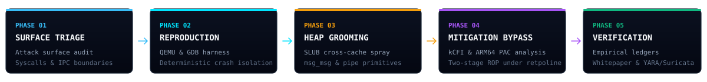
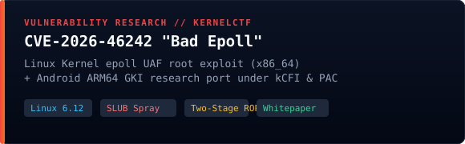
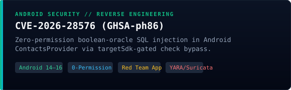
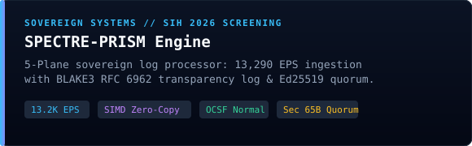
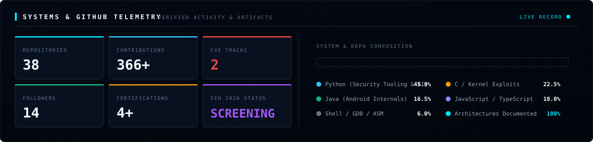

<div align="center">



<br/>

<a href="https://www.linkedin.com/in/aayushbankar/"></a>
<a href="https://aayushbankar.github.io/"></a>
<a href="mailto:aayushbankar42@gmail.com"></a>
<a href="https://github.com/Aayushbankar?tab=repositories"></a>

<br/>

<a href="https://cyphermatrix.io/"></a>
<a href="https://github.com/Aayushbankar/spectre-prism"></a>
<a href="https://en.wikipedia.org/wiki/Gandhinagar"></a>
<a href="https://github.com/Aayushbankar?tab=followers"></a>

</div>


<h2><samp>&#9608;&#9617;&nbsp;&nbsp;01 &#8212; IDENTITY</samp></h2>



I research low-level memory corruption and architect sovereign systems where execution integrity is mathematically verifiable. Most of my work sits at the boundary between **operating system internals**, **exploit primitive synthesis**, and **high-throughput architectures**:

- **Triage &amp; Dissect** &#8212; Linux kernel race conditions, epoll subsystem UAF, SLUB allocator mechanics, and Android framework-level access control bypasses.
- **Groom &amp; Synthesize** &#8212; Cross-cache slab reclamation (`msg_msg`, pipe buffers), two-stage ROP pivoting under retpoline, and hardware mitigation audits (kCFI, ARM64 PAC).
- **Architect &amp; Isolate** &#8212; 5-plane sovereign log processing engines, zero-copy SIMD ingestion, and RFC 6962 verifiable transparency ledgers.
- **Verify &amp; Disclose** &#8212; Empirical verification ledgers (42 claims), YARA/Suricata signatures, and responsible vendor reporting.

> Scoped, authorized research and reproduction only. Every finding is backed by an empirical verification ledger.


<h2><samp>&#9608;&#9617;&nbsp;&nbsp;02 &#8212; RESEARCH &amp; VERIFICATION METHODOLOGY</samp></h2>



| Phase | Operational Scope &amp; Deliverables |
| :--- | :--- |
| **01 Threat Model** | Audit target attack surfaces, security advisories, and architecture trust boundaries before writing test harnesses. |
| **02 Lab Harness** | Stand up reproducible QEMU/KVM virtual machines, AVD emulators, or isolated containers with automated debug tooling. |
| **03 AI Synthesis** | Direct multi-agent technical prompts, orchestrate code synthesis, and guide low-level exploit primitives or system pipelines. |
| **04 Proof Ledger** | Log all test vectors, telemetry runs, memory dumps, and reproduction timestamps into mathematically auditable verification ledgers. |
| **05 Harden &amp; Disclose** | Produce defensive signatures (YARA/Suricata), architect patch mitigations, and submit coordinated disclosures to upstream vendors. |


<h2><samp>&#9608;&#9617;&nbsp;&nbsp;03 &#8212; FIELD RESEARCH &amp; FLAGSHIP SYSTEMS</samp></h2>

<table>
<tr>
<td width="50%" valign="top">
<a href="https://github.com/Aayushbankar/bad_epoll_ab_tier2"></a>
</td>
<td width="50%" valign="top">
<a href="https://github.com/Aayushbankar/cve-2026-28576"></a>
</td>
</tr>
<tr>
<td width="50%" valign="top">
<a href="https://github.com/Aayushbankar/spectre-prism"></a>
</td>
<td width="50%" valign="top">
<a href="https://github.com/Aayushbankar/wolvie"></a>
</td>
</tr>
</table>

<details>
<summary><samp><b>&#9656;&nbsp; ADDITIONAL PRODUCTION REPOSITORIES &amp; SYSTEMS</b></samp></summary>

<br/>

| Repository | Scope &amp; Technical Highlights | Domain |
| :--- | :--- | :--- |
| [**Quantlab**](https://github.com/Aayushbankar/Quantlab) | Algorithmic trading backtesting engine explicitly modeling slippage, trading friction, and out-of-sample decay. | Fintech / Simulation |
| [**cve_aggregator**](https://github.com/Aayushbankar/cve_aggregator) | Threat intelligence platform aggregating NVD API v2.0, CISA KEV, and GitHub Advisories with composite risk scoring. | Threat Intelligence |
| [**onetimeshare**](https://github.com/Aayushbankar/onetimeshare) | Ephemeral file-sharing service using atomic Redis TTL transactions to eliminate race conditions on one-time downloads. | Secure Backend |
| [**it (itgpg.github.io)**](https://itgpg.github.io/it/) | Official production website for Govt. Polytechnic Gandhinagar IT Department serving 500+ daily academic users. | Production Web |
| [**privata**](https://github.com/Aayushbankar/privata) | Privacy-preserving document query engine using offline embeddings (Sentence Transformers) and ChromaDB. | Applied AI / RAG |

</details>


<h2><samp>&#9608;&#9617;&nbsp;&nbsp;04 &#8212; TECHNICAL ARSENAL</samp></h2>

<table>
<tr><td align="right" width="180"><samp><b>SYSTEMS &amp; KERNEL</b></samp></td><td>


</td></tr>

<tr><td align="right"><samp><b>SECURITY &amp; AUDIT</b></samp></td><td>


</td></tr>

<tr><td align="right"><samp><b>LANGUAGES &amp; APIS</b></samp></td><td>


</td></tr>

<tr><td align="right"><samp><b>CRYPTO &amp; PROVENANCE</b></samp></td><td>


</td></tr>

<tr><td align="right"><samp><b>APPLIED AI &amp; AUDIO</b></samp></td><td>


</td></tr>
</table>


<h2><samp>&#9608;&#9617;&nbsp;&nbsp;05 &#8212; TELEMETRY</samp></h2>

<div align="center">



<br/><br/>

### 🛡️ Verified Credentials &amp; Certifications
**Certified AppSec Practitioner v2 (CAP)** &nbsp;•&nbsp; **Certified Network Security Practitioner (CNSP)** &nbsp;•&nbsp; **IBM SkillsBuild (48/50)**

</div>


<h2><samp>&#9608;&#9617;&nbsp;&nbsp;06 &#8212; CURRENT OPS</samp></h2>

```console
$ tail -f ~/ops/NOW.log

[ACTIVE]  CVE-2026-46242 :: Android GKI 6.1 ARM64 mechanical preemption verification
[ACTIVE]  SPECTRE-PRISM  :: SIH 2026 screening prep + 13K EPS benchmark telemetry
[ACTIVE]  QuantLab       :: transaction cost decay model & college minor project wrap
[ONGOING] Wolvie         :: ultra-low latency local VAD & WebRTC audio pipeline tuning
[ONGOING] Systems Rehab  :: daily unassisted zero-AI low-level socket & C implementations
```

<table>
<tr>
<td width="50%" valign="top">

**Open to collaborate on**

- Linux kernel &amp; Android vulnerability research
- High-throughput sovereign data pipelines &amp; log engines
- Real-time local speech &amp; edge AI companion systems
- Collegiate &amp; National CTF challenge authoring

</td>
<td width="50%" valign="top">

**How I work best**

- Empirical verification ledgers &#8212; proof over claims
- Documented reproductions that succeed on the first run
- Systems architecture first, implementation rigor second
- Scoped, authorized testing &amp; responsible disclosure

</td>
</tr>
</table>


<h2><samp>&#9608;&#9617;&nbsp;&nbsp;07 &#8212; CHANNELS</samp></h2>

<div align="center">

<a href="https://www.linkedin.com/in/aayushbankar/"></a>
<a href="https://aayushbankar.github.io/"></a>
<a href="mailto:aayushbankar42@gmail.com"></a>
<a href="https://github.com/Aayushbankar"></a>

<br/><br/>



</div>
